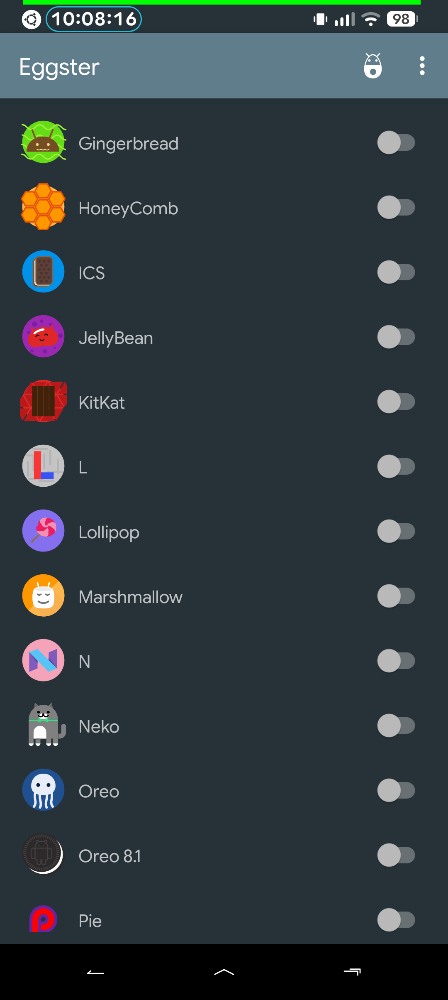
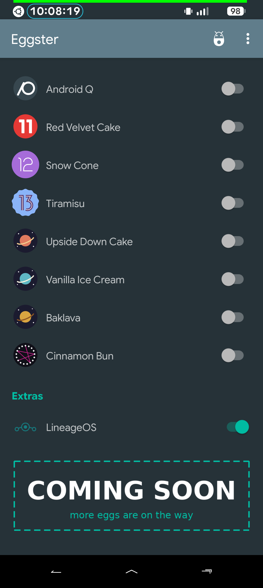
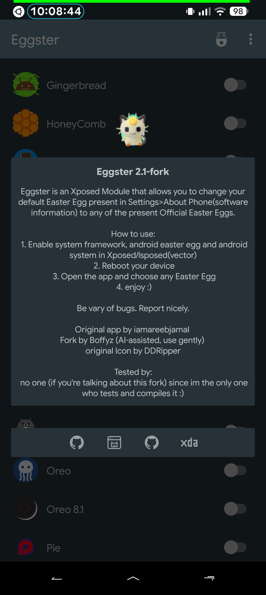

Eggster ReACTV
==============

	  

  

Xposed Module for changing Android Easter Eggs, the little interactive thing that shows when you click on android version for 6 times (access it though settings>about device>software information)

supports from **Android GingerBread**, all the way to **Vanilla Ice Cream (Android 15)** with (and without) *Root*

## But why?

the original repo only had a few easter eggs+i wanted to learn how to make Android Root/Xposed apps :3

## Do i need Root/Xposed for this app to work?

no, it can **work without root**

> [!CAUTION]
> If you don't have Root yet want to Root your Phone, please bear in mind that Rooting comes with a number of risks and "downsides"

## How?

with the help of claude (im sorry)

## vibecoded ai slop >>>:((((

*👍*

## where to download?

**bro**

## Screenshots?

	
	
	
	
	
	
	
	
	

## found a bug, what do i do?

Open an issue (duh)

Please include:
- **Android version**
- **Device model**
- **what you ate yesterday**
- **Xposed(lsposed/vector) framework version**
- **Steps to reproduce the issue**
- **Relevant Logs**
- **your favorite pet**
  
(Please don't just say *"it doesn't work"* 😭)

## cool project! how can i support it?

thanks! currently i have no plans to open a buymeacoffee/ko-fi page (or kofe.al if you're from Azerbaijan) because tbh im not on the legal age to have a personal bank account/debit card, but you can star this project or leave a suggestion on what should i add to this forked project :)
